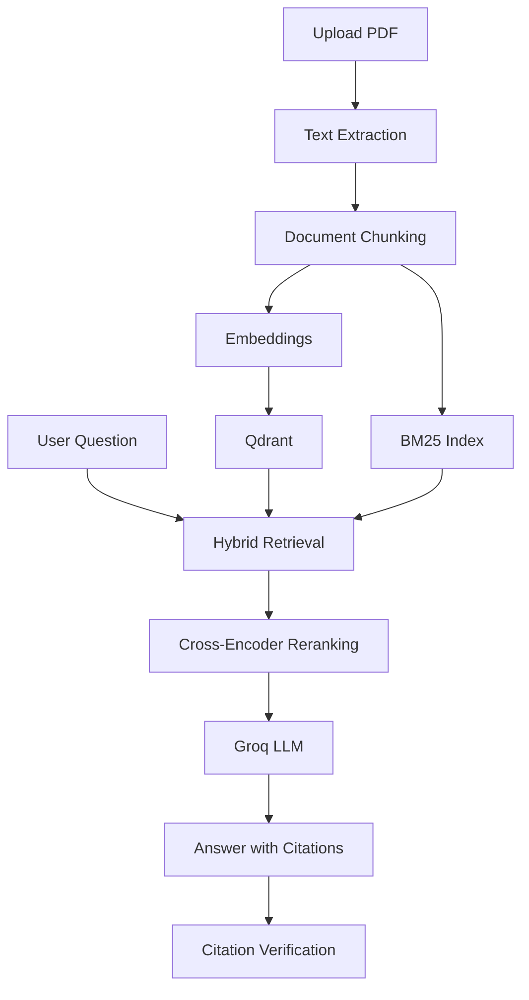

# PDF Chat

An AI-powered question-answering application for PDF documents. Upload a PDF, ask questions in natural language, and receive answers grounded in the document, with source citations and automated verification that the cited passages support the answer.

## Features

- **PDF Processing:** Extracts text from PDFs and splits it into overlapping chunks for retrieval.
- **Hybrid Search:** Combines dense vector search (Qdrant) with keyword search (BM25) to capture both semantic and exact-term matches.
- **Cross-Encoder Reranking:** Re-scores retrieved passages with a cross-encoder to surface the most relevant context.
- **AI-Powered Answers:** Generates context-aware responses using Groq-hosted LLMs.
- **Source Citations:** Links each answer to the document passages it was drawn from.
- **Citation Verification:** Checks whether the cited sources actually support the generated answer.

## Architecture



**Ingestion:** Uploaded PDFs are parsed with PyMuPDF, chunked, embedded, and indexed in both Qdrant and BM25.

**Query:** Each question runs through hybrid retrieval, is reranked by a cross-encoder, and is passed to a Groq LLM. The generated answer is then verified against its cited sources.

## Tech Stack

- **Backend:** FastAPI
- **Frontend:** Streamlit
- **Vector Database:** Qdrant
- **LLM Provider:** Groq
- **Keyword Search:** BM25
- **Embeddings & Reranking:** Sentence Transformers
- **PDF Parsing:** PyMuPDF

## Project Structure

```text
chat-pdf-chat/
├── app/
│   ├── api/
│   │   └── routes.py            # API endpoints
│   ├── generation/
│   │   ├── llm.py               # Groq LLM client
│   │   └── pipeline.py          # Answer generation and citation verification
│   ├── ingestion/
│   │   ├── chunker.py           # Document chunking
│   │   ├── file_hasher.py       # Duplicate-upload detection
│   │   ├── pdf_loader.py        # PDF text extraction
│   │   └── pipeline.py          # Ingestion orchestration
│   ├── retrieval/
│   │   ├── bm25_retriever.py    # Keyword retrieval
│   │   ├── embedder.py          # Embedding generation
│   │   ├── hybrid_retriever.py  # Combined vector + keyword retrieval
│   │   ├── reranker.py          # Cross-encoder reranking
│   │   └── vector_store.py      # Qdrant integration
│   └── main.py                  # FastAPI application entry point
├── frontend/
│   └── app.py                   # Streamlit user interface
├── scripts/                     # Utility scripts
├── tests/                       # Test suite
├── pyproject.toml               # Project metadata and dependencies
├── uv.lock                      # Locked dependency versions
└── .gitignore
```

## Getting Started

### Prerequisites

- Python 3.10 or later
- [uv](https://docs.astral.sh/uv/) package manager
- A running Qdrant instance (local or hosted)
- A Groq API key

### Installation

```bash
git clone <your-repo-url>
cd chat-pdf-chat
uv sync
```

### Configuration

Create a `.env` file in the project root and set the required environment variables:

```env
GROQ_API_KEY=your_groq_api_key
QDRANT_URL=http://localhost:6333
```

### Running the Application

Start the FastAPI backend:

```bash
uv run uvicorn app.main:app --reload
```

In a separate terminal, start the Streamlit frontend:

```bash
uv run streamlit run frontend/app.py
```

The Streamlit interface will be available at `http://localhost:8501`, and the API at `http://localhost:8000`.

## Usage

1. Open the Streamlit interface in your browser.
2. Upload a PDF document.
3. Wait for ingestion to complete.
4. Ask a question about the document.
5. Review the generated answer, its source citations, and the verification result.

## License

This project is licensed under the [MIT License](LICENSE).
